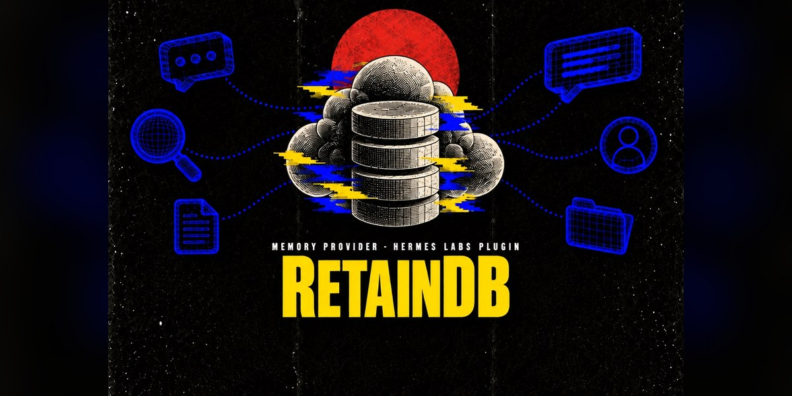

<p align="center"></p>

# RetainDB Memory Provider

> **Labs plugin: works, but unsupported.** RetainDB is now a Hermes Labs plugin: built by Nous Research, not supported, and likely not maintained going forward. Fixes from the community are welcome. See [what "labs" means](../README.md#what-labs-means).

Part of [Hermes Labs Plugins](../README.md): built by Nous Research, **not supported**. Formerly built into
[hermes-agent](https://github.com/NousResearch/hermes-agent) core (`plugins/memory/retaindb`); this directory carries its full history.
Profiles that had `memory.provider: retaindb` get this plugin installed automatically by `hermes update` or the next agent start.

## Install

```bash
hermes plugins install retaindb
hermes config set memory.provider retaindb
```

Cloud memory API with hybrid search (Vector + BM25 + Reranking) and 7 memory types.

## Requirements

- RetainDB account ($20/month) from [retaindb.com](https://www.retaindb.com)
- `requests` is part of Hermes's core dependencies; no separate SDK install is needed. For damaged dependencies, use `hermes pm repair` and restart Hermes.

## Setup

```bash
hermes memory setup    # select "retaindb"
```

Or manually:
```bash
hermes config set memory.provider retaindb
echo "RETAINDB_API_KEY=your-key" >> ~/.hermes/.env
```

## Config

All config via environment variables in `.env`:

| Env Var | Default | Description |
|---------|---------|-------------|
| `RETAINDB_API_KEY` | (required) | API key |
| `RETAINDB_BASE_URL` | `https://api.retaindb.com` | API endpoint |
| `RETAINDB_PROJECT` | auto (profile-scoped) | Project identifier |

## Tools

| Tool | Description |
|------|-------------|
| `retaindb_profile` | User's stable profile |
| `retaindb_search` | Semantic search |
| `retaindb_context` | Task-relevant context |
| `retaindb_remember` | Store a fact with type + importance |
| `retaindb_forget` | Delete a memory by ID |
